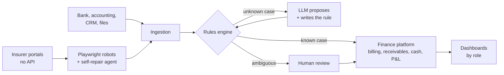

### Clément Malard
 
Head of Finance, ex-M&A and Transaction Services (Deloitte, Eight Advisory). I build the tools my team runs on, AI-first with Claude Code, and measure them by daily usage and time saved.
 

 
**Three principles behind everything I ship**
 
- **Rules first, LLM last.** Deterministic rules handle the known cases; the LLM only sees what is undocumented, then writes the rule for next time. Token usage trends toward zero.
- **Refuse to guess.** When two answers are equally plausible, the system stops and routes the case to a human. No silent wrong numbers.
- **Spec, tests, then ship.** Spec, tests first, pull request with CI and AI review, staging, production, decision record.
  
Result: month-end close from D+20 to D+5, 10+ hours a week released, tools used daily by the CEO, the accountant and 50+ people.
 
`TypeScript` `Python` `Cloudflare Workers` `Astro` `Hono` `Playwright` `n8n` `Power BI`
 
Most of my work lives in private company repositories. Happy to walk through it live. [LinkedIn](https://www.linkedin.com/in/clément-malard)
 
